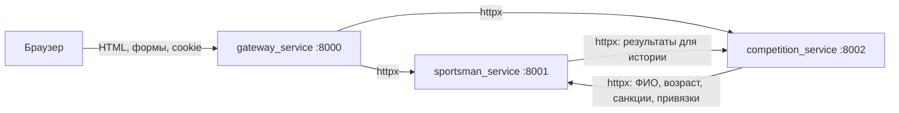
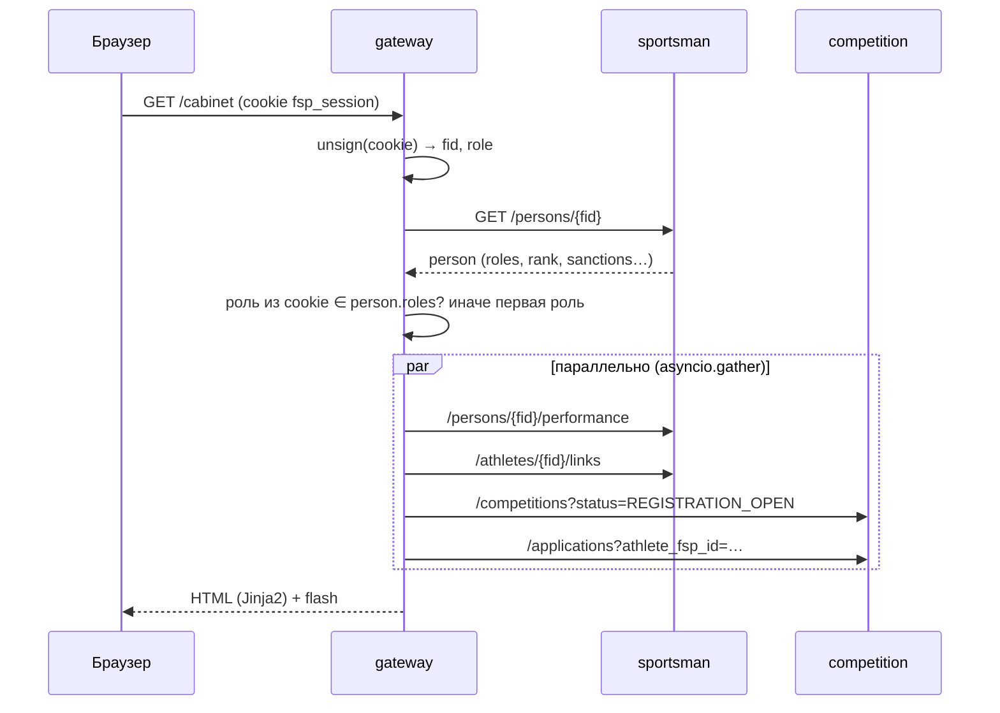

# 2. Архитектура

## Сервисы

| Сервис | Владеет данными | Ключевые обязанности |
|---|---|---|
| `sportsman_service` | Person, TrainerLink, санкции, аудит | Регистрация и **выдача ФСП ID** (только здесь), проверка пароля, связи тренер↔спортсмен и их переходы, алерты сроков, агрегат выступлений (`/performance`) |
| `competition_service` | Competition, Protocol, Application, Document, настройки рейтинга, аудит | Календарь, парсинг логов, live-поток, публикация, рейтинг, заявки с проверкой допуска, назначения судей, KPI, справки |
| `gateway_service` | Ничего не хранит (только подписанные cookie) | UI, сессия и активная роль, ролевые проверки, публичный API-шлюз с allowlist, QR. Код: `main.py` (приложение, кабинеты), `web.py` (общий слой), `routes/` (реестр, модерация, журнал, лента), `listing_ui.py` |

Хранение двухрежимное. **Без `FSP_DATABASE_URL`** сервис держит данные в памяти и засевает их при старте
(`lifespan` → `seed`); перезапуск возвращает демо-данные к исходным.
**С `FSP_DATABASE_URL`** (Postgres) состояние персистентно — см. ниже.

### Персистентность (Postgres)

`shared/db.py` (`Persistence`): каждая сущность — строка `(key TEXT PK, data JSONB[, доп. колонки])`.
Сервис отдаёт снимок состояния (`snapshot(store)` в своём `store.py`), слой считает хэши и пишет в БД только
изменённые строки, исчезнувшие удаляет. Запись — middleware после каждого запроса, кроме `GET`.

| Сервис | Таблицы |
|---|---|
| `sportsman_service` | `sp_persons` (+ колонка `email`, уникальный индекс по `lower(email)`), `sp_links`, `sp_requests`, `sp_meta` (счётчики ФСП ID/связей, аудит) |
| `competition_service` | `comp_competitions`, `comp_protocols`, `comp_applications`, `comp_teams`, `comp_documents`, `comp_meta` (настройки рейтинга, типы, счётчик справок, аудит) |

Старт: `db.init()` создаёт таблицы; если БД пуста — сид и первичная запись, иначе `restore()` читает состояние из БД.
В competition сид выполняется всегда (календарь и воспроизводимые live-протоколы транзиентны), сохранённое состояние
накладывается сверху; протоколы live-соревнований остаются из сида. Хэши пароля лежат в `data` персоны.

Межсервисные вызовы — `shared/http.py`: один пулированный `httpx.AsyncClient` на downstream-сервис,
заголовок `X-FSP-Caller`, единая ошибка `ServiceError(service, status, detail)`; сетевой сбой → статус `503`.

Взаимная зависимость `competition ↔ sportsman` допустима: каждый вызов обёрнут в обработку `ServiceError`,
и при недоступности соседа сервис отвечает частичными данными (например, рейтинг без проверки санкций
помечается `sanctions_checked: false`).

## Типовой запрос страницы

`current_user()` кэширует пользователя в `request.state` на время запроса.

## Сессии и роли

- `gateway_service/session.py`: cookie `fsp_session` = base64(JSON `{fid, role, exp}`) + HMAC-SHA256
  (32 hex), TTL 12 часов, `HttpOnly`, `SameSite=Lax`. Сессия переживает перезапуск шлюза.
- Активная роль заново сверяется с реестром на каждом запросе — отзыв роли действует сразу.
- `require(request, *roles)`: нет сессии → редирект на `/login?next=…`; роль не подходит → `403`
  с подсказкой переключить роль.
- `POST /role` разрешает только роли из `person.roles` (эскалация до `admin` даёт `403`).
- Flash-сообщения — одноразовая подписанная cookie `fsp_flash` (60 с): `{kind, text, …extra}`.
  `kind`: `ok`, `error`, `fsp_issued`; `extra` используется для `celebrate` и `app_id`.
- Редирект после входа принимает только относительные пути (`/…`, не `//…`).

## Деградация

`safe(coro, default, degraded)` в шлюзе: при `ServiceError` записывает строку в `degraded` и возвращает
значение по умолчанию. Шаблон показывает `[WARN] <сервис>: … интерфейс работает в деградированном режиме`
(`m.degraded_notice`). Страница не падает, если упал один из сервисов.
Ошибки `ServiceError` без `safe` обрабатывает общий handler → страница `error.html` с кодом и сервисом.

## Публичный API-шлюз

`GET /api/public/{service}/{path}` проксирует только allowlist (`_PUBLIC_ROUTES`):

- competition: `api/v1/competitions`, `api/v1/competitions/{id}`, `api/v1/competitions/{id}/protocol`,
  `api/v1/rating`, `api/v1/rating/settings`, `api/v1/documents/{номер}/verify`;
- sportsman: только `api/v1/stats`.

Реестр с персональными данными наружу не публикуется (e2e проверяет `404` на `/persons`).

## Доверие между сервисами

Внутренние сервисы доверяют шлюзу: ролевые проверки выполняет gateway, а сервисы проверяют
бизнес-правила (допуск, переходы статусов, участники связи). Поле `actor`/`submitted_by` в запросах
заполняет шлюз из сессии. В продакшене нужны mTLS или служебные токены (см. [решения](09-decisions.md)).

## Конфигурация (`shared/config.py`)

| Переменная | По умолчанию | Назначение |
|---|---|---|
| `FSP_GATEWAY_PORT` / `FSP_SPORTSMAN_PORT` / `FSP_COMPETITION_PORT` | 8000 / 8001 / 8002 | Порты |
| `FSP_HOST` | `127.0.0.1` | Хост для всех сервисов |
| `FSP_SPORTSMAN_URL` / `FSP_COMPETITION_URL` | `http://{HOST}:{PORT}` | Адреса downstream-сервисов |
| `FSP_PUBLIC_BASE_URL` | `http://localhost:8000` | База для QR-ссылок проверки справок |
| `FSP_SECRET_KEY` | `dev-only-fsp56-change-me` | HMAC для сессий, flash и кодов справок — **обязательно сменить вне dev** |
| `FSP_SERVICE_TIMEOUT` | `5.0` | Таймаут межсервисных вызовов, с |
| `FSP_DEMO_TODAY` | — | Зафиксировать «сегодня» (`YYYY-MM-DD`) для воспроизводимой демонстрации |
| `FSP_DEMO_SCALE` | `0` | Добавить N синтетических людей и их заявки (`shared/demo_scale.py`) — проверка работы с большими списками |
| `FSP_TELEGRAM_TOKEN` / `FSP_TELEGRAM_BOT` | — | Токен и username бота уведомлений. Читаются из `.env` в корне (в git не попадает); без токена уведомления выключены |
| `FSP_PDF_FONT` / `FSP_PDF_FONT_BOLD` | поиск Arial / DejaVu / Liberation | TTF-шрифт с кириллицей для выгрузки в PDF |

Все даты демо-данных считаются от `config.today()`, поэтому сроки и статусы всегда «живые».

## Стек

Python 3.14, FastAPI 0.135 / Starlette 1.0, Uvicorn, Jinja2, httpx, python-multipart, segno (QR в SVG),
openpyxl / python-docx / reportlab (выгрузка документов в .xlsx / .docx / .pdf, только в шлюзе).
UI: Tailwind CSS (CDN, конфиг в `base.html`), шрифты JetBrains Mono + Inter (CDN), ванильный JS без сборки.
