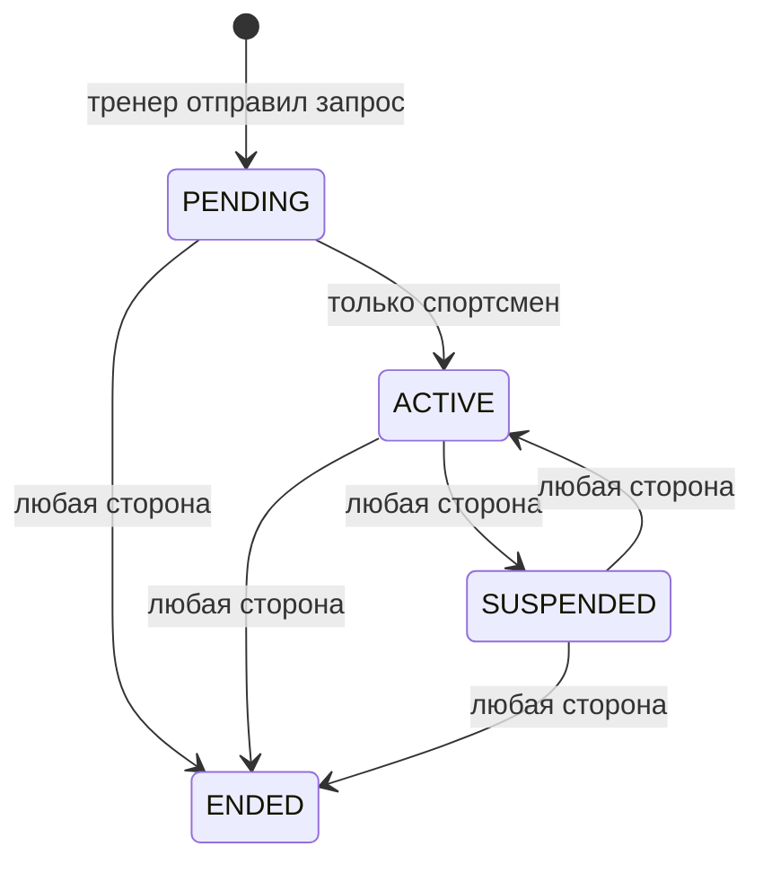
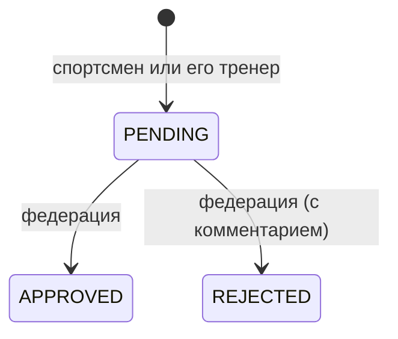

# 3. Предметная область

Все справочники и enum-статусы с русскими подписями — в `shared/domain.py`. В шаблонах они доступны
как глобальная переменная `D` (например, `D.DISCIPLINE_BY_CODE[code].short`).

## ФСП ID

Формат `FSP-RR-YY-NNNNN-C` (`shared/fsp_id.py`):

| Часть | Пример | Смысл |
|---|---|---|
| `RR` | `56` | Код региона (Оренбургская область) |
| `YY` | `25` | Год регистрации |
| `NNNNN` | `00008` | Порядковый номер |
| `C` | `7` | Контрольная цифра по алгоритму Луна от `RR+YY+NNNNN` |

`make_fsp_id(year, seq)` строит ID, `is_valid_fsp_id()` проверяет формат и контрольную цифру.
**Выдаёт** ID только `sportsman_service` (`store.issue_fsp_id`); проверяют все (например, парсер логов
отклоняет строки с неверной контрольной цифрой). Регион берётся из ID: участники с `RR ≠ 56`
попадают в протоколы, но не рейтингуются.

## Участник (Person)

Ключевые поля: ФИО, пол, дата рождения, муниципалитет, организация, `roles[]`, `disciplines[]`,
`rank`, `judge_category`, `sanctions[]`, `guardian`, `pd_consent_at`, `start_year`, email, хеш пароля,
`training_stage` (этап спортивной подготовки при наличии: `НП`, `УТ`, `ССМ`, `ВСМ` — `TRAINING_STAGES`),
`antidoping` (`course_date` и `certificate_url` курса РУСАДА; вносит сам спортсмен в кабинете).

**Дисциплины** спортсмен выбирает сам в кабинете («Мои дисциплины»), федерация — любому (`PUT /api/v1/persons/{id}/disciplines`). Нужна хотя бы одна (спортсмену и тренеру). От них зависят календарь, заявки и рейтинг. Снятая командная дисциплина выводит из её команды.

Организации — справочник `ORGANIZATIONS` + карточки `ORGANIZATION_INFO` (тип, муниципалитет); состав и счётчики
считает `GET /api/v1/organizations`. «Без организации» (`NO_ORGANIZATION`) — значение, а не организация.

`store.present()` добавляет вычисляемые поля, на которые опирается UI:
`age`, `is_minor` (< 18), `is_sanctioned` (есть действующая санкция), `full_name`,
а у `rank` и `judge_category` — `days_left` и `state`.

Роли: `admin` (федерация), `athlete`, `trainer`, `judge` и `ministry` — министерство спорта, только чтение; её выдаёт федерация, при самостоятельной регистрации она недоступна.

Регистрация (`POST /api/v1/persons`): email уникален; возраст ≥ 6 лет; для младше 18 обязательны ФИО
и согласие законного представителя; согласие на обработку ПДн (152-ФЗ) проверяет шлюз.
Пароль хранится как `pbkdf2_sha256$iterations$salt$digest`.

## Разряды и категории

ЕВСК (`SPORT_RANKS`, по возрастанию): 3Ю, 2Ю, 1Ю, 3, 2, 1 — срок 2 года; КМС — 3 года;
МС — бессрочно (`validity_years=None`). `RANK_ORDER` используется для фильтра «разряд не ниже».

Судейские категории (`JUDGE_CATEGORIES`): ЮС, 3К, 2К, 1К, ВК. Судейские должности: главный судья,
главный секретарь, заместитель главного судьи, судья, технический судья.

### Состояние срока — `expiry_state(days_left)`

| `state` | Условие | Как выглядит |
|---|---|---|
| `none` | Срока нет (бессрочно) | «бессрочно» |
| `expired` | `days_left < 0` | красный «истёк · N дн. назад» |
| `critical` | `≤ 30` (`EXPIRY_CRITICAL_DAYS`) | жёлтый «≤30 дн · осталось N» |
| `warning` | `≤ 90` (`EXPIRY_WARNING_DAYS`) | фиолетовый «≤90 дн · осталось N» |
| `ok` | больше 90 | зелёный «действует до …» |

Разряд подтверждается результатом на соревновании, поэтому при `expired/critical/warning`
кабинеты предлагают подать заявку на ближайший подходящий старт.

## Санкции

Типы: `DISQUALIFICATION` (дисквалификация), `SUSPENSION` (отстранение); период `date_from…date_to`, причина.
Действующая санкция:

- исключает спортсмена из рейтинга сезона (с причиной в блоке «Исключены из рейтинга»);
- блокирует подачу заявок (`422`);
- показывается первой в «Что сделать сейчас».

Снятая (прошедшая) санкция ни на что не влияет (пример — Хасанов).

## Соревнование (Competition)

Поля: `code` (`ОРБ-{дисциплина}-{год}-{id:02d}`), название, дисциплина, `level`, тип
(из [справочника типов](#справочник-типов-соревнований)), `format` (+ пояснение), календарный план и номер, даты, место,
возрастная группа, статус, срок приёма заявок, судейская коллегия.

| Справочник | Значения |
|---|---|
| Уровень `CompetitionLevel` | `CHAMP_RU` Чемпионат России, `FIRST_RU` Первенство России, `INTERREG` межрегиональные (в т.ч. окружные), `REGIONAL` региональные |
| План `CalendarPlan` | `EKP` ЕКП Минспорта России, `REGIONAL` план Оренбургской области |
| Формат `CompetitionFormat` | `OFFLINE` очно, `ONLINE` онлайн, `HYBRID` смешанный |

Возрастные группы (`AGE_GROUPS`, включительно): 10–13, 14–17, юниоры 16–21, 18+, «без ограничений 12+».

### Жизненный цикл соревнования

Статусы: `PLANNED` → `REGISTRATION_OPEN` → `REGISTRATION_CLOSED` → `LIVE` → `FINISHED`.
Статус меняется в трёх местах:

- при создании (`POST /api/v1/competitions`) статус = `REGISTRATION_OPEN`, если срок приёма заявок
  ещё не прошёл, иначе `PLANNED`;
- **вручную федерацией** — открытие и закрытие приёма заявок (`POST …/registration`, см. ниже);
- публикация протокола (`POST …/protocol/publish`) переводит соревнование в `FINISHED`.

Переходы к `LIVE` и `FINISHED` по датам автоматически не происходят — их задаёт сид.
Приём заявок дополнительно закрывается по дате `registration_deadline`, даже если статус ещё `REGISTRATION_OPEN`
(в календаре такое соревнование помечено `registration_expired`).

### Ручное открытие и закрытие приёма заявок

`POST /api/v1/competitions/{id}/registration` `{action: open|close, deadline?, actor}`:

| Действие | Правила |
|---|---|
| `close` | Только из `REGISTRATION_OPEN` (иначе `409`). Подача останавливается сразу; поданные заявки остаются на модерации |
| `open` | Из `PLANNED` / `REGISTRATION_CLOSED`. Срок окончания — `deadline` или прежний; он не должен быть в прошлом и позже начала соревнования (`422`). Если соревнование уже началось — `422` |
| `open` при уже открытом приёме | Продление: нужен новый `deadline`, без него `409` |
| любое при `LIVE` / `FINISHED` | `422` |

Кабинет федерации → вкладка «Соревнования» → раздел «Приём заявок». При открытии уведомление уходит в Telegram всем подключённым.

### Справочник типов соревнований

Хранится в `competition_service` (`store.competition_types`), стартовое наполнение — `DEFAULT_COMPETITION_TYPES`
(Чемпионат, Первенство, Кубок, Турнир). Федерация пополняет его в кабинете (раздел «Новое соревнование»):
`POST /api/v1/competition-types` — название 3–40 символов, пробелы схлопываются, дубль без учёта регистра — `409`.
Удалить можно только тип, который не используется ни одним соревнованием (`DELETE`, иначе `409`).
Создание соревнования с типом вне справочника — `422`.

Только опубликованные протоколы попадают в рейтинг, историю спортсменов и справки.
При загрузке лога в уже завершённое соревнование протокол сразу считается опубликованным.

## Связь тренер ↔ спортсмен (TrainerLink)

Создаёт только тренер (`PENDING`); спортсмен должен заниматься этой дисциплиной; дубль активной связи
по той же дисциплине — `409`. Каждое изменение пишется в `history[]`.

Источник правил — `_TRANSITIONS` в `sportsman_service/main.py`. Менять связь могут только её участники.

## Заявка (Application)

Проверки при подаче (`competition_service`, `POST /api/v1/applications`):

1. соревнование в статусе `REGISTRATION_OPEN` и срок приёма не прошёл;
2. у участника роль «Спортсмен» и дисциплина соревнования;
3. нет действующей санкции;
4. возраст **на дату начала соревнования** входит в возрастную группу (`age_group_fit` в `shared/domain.py`): кому 13 сегодня и 14 к старту, допускается в группу 14–17, а 17-летнего, которому к старту исполнится 18, в неё не примут;
5. подаёт сам спортсмен **или** тренер с `ACTIVE`-привязкой по этой дисциплине (иначе `403`);
6. нет другой неотклонённой заявки на это соревнование (`409`). После отклонения можно подать повторно.

## Протокол (Protocol)

`raw_log[]` (строки FSP-LOG/1), `results[]` (итоги, внесённые федерацией), `mode` (`icpc` для ALG/SEC,
`score` для остальных — `protocol_mode()`), снимок имён, `entries[]` (место, статус, решено, штраф, баллы жюри,
задачи, базовые баллы рейтинга), `published`, `source` (`seed`/`live`/`upload`/`manual`).

Два способа сформировать протокол:

- **ручной ввод** (`manual`) — федерация вносит результаты участников с одобренными заявками, места считаются
  автоматически; это основной путь по кейсу;
- **лог соревнования** (`upload`, `live`) — для онлайн-платформ, выдающих FSP-LOG/1.

Соревнование, которое уже началось, у которого есть одобренные заявки и нет опубликованного протокола,
помечается `awaiting_results` («ждёт результатов»). Черновик протокола видит только федерация; опубликованный
протокол по форме (`/protocols/{id}`) публичен. Подробности — в [алгоритмах](04-algorithms.md).

## Справка об участии (Document)

Номер `56-{год}-{NNNNN}`, код проверки = первые 12 hex HMAC-SHA256(`номер|fsp_id|competition_id`) в верхнем
регистре. Формируется только по опубликованному протоколу и только для участника этого протокола.
Видит владелец и федерация; проверить подлинность может кто угодно по QR.

## Команда участников (Squad)

Командные дисциплины — алгоритмика (`ALG`), продуктовое программирование (`PRD`), CTF (`SEC`, кибербезопасность) и ИИ (`AI`): `TEAM_DISCIPLINES` в `shared/domain.py`. Команду собирают сами спортсмены; не путать со сборной ниже, которую формирует федерация приказом.

Поля: название, дисциплина, капитан, `members[]` (ФСП ID), `invites[]` (кому, кто, когда). Правила (`sportsman_service/squads.py`):

- создать команду может спортсмен, у которого дисциплина есть в профиле; создатель — капитан. Название уникально в дисциплине без учёта регистра;
- в каждой дисциплине спортсмен состоит не более чем в одной команде; в составе не больше `TEAM_MAX_SIZE` (5 — рабочее значение, сверить с положением);
- капитан приглашает по ФСП ID спортсмена с той же дисциплиной; приглашённый принимает или отклоняет; принятие снимает остальные приглашения этой дисциплины;
- капитан отзывает приглашения, исключает участников (не себя) и распускает команду; федерация тоже может исключить и распустить;
- участник выходит сам: капитан передаётся следующему по списку, последний выход распускает команду;
- о приглашении, ответе, исключении, смене капитана и роспуске приходят уведомления в ленту.

Заявки на старты по-прежнему подаются на спортсмена; привязки команды к заявке пока нет.

## Сборная команда (Team)

Состав набирается **вручную из отфильтрованного рейтинга**: на `/rating` федерация отмечает спортсменов
(фильтры сезона, возраста и разряда сохраняются как основание). Поля: название, дисциплина, сезон, цель
формирования, фильтры, `members[]`, статус `DRAFT` / `APPROVED`, номер и дата приказа.

Участник сборной — снимок на момент включения: место и баллы рейтинга, разряд, муниципалитет, организация,
дата рождения, тренеры (активные связи по дисциплине), роль `MAIN` (основной состав) / `RESERVE` (резерв).

Правила (`competition_service`, `/api/v1/teams…`):

- в состав попадает только тот, кто есть в рейтинге по тем же фильтрам; исключённые по санкциям — нельзя (`422`);
  если реестр недоступен, санкции не проверить и состав не меняется (`503`);
- спортсмена, добавленного позже, ставят в резерв; нельзя оставить сборную без основного состава или без участников;
- `approve` требует номер приказа (с цифрой) и дату; после этого состав, название и цель закрыты (`409`),
  а в документах появляются реквизиты приказа. Удалить можно только черновик.

Документы: список сборной и проект приказа (`.xlsx`, `.docx`, `.pdf`) — страница `/teams/{id}`.
Проект приказа готовит федерация, издаёт его министерство (`ORDER_ISSUER` в `shared/domain.py`); текст — шаблон.
